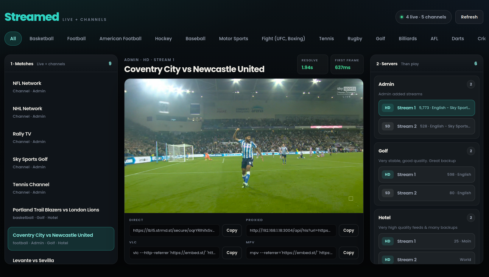
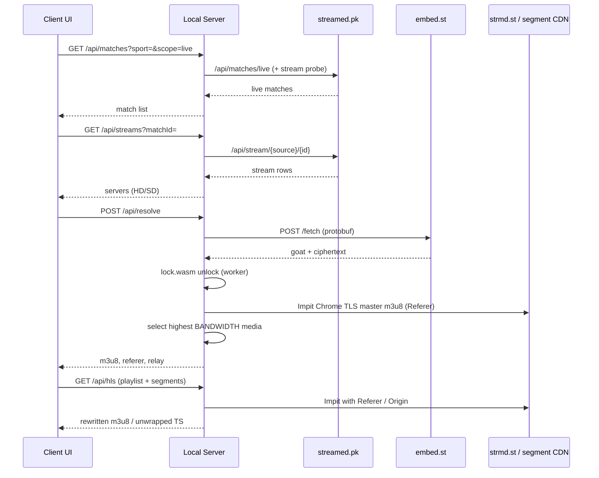

<div align="center">

# 📡 Streamed.pk HLS Stream Resolver

**Self-hosted HLS stream resolver for [streamed.pk](https://streamed.pk) live sports.**

Turn any match + server selection into a playable `m3u8` — replaying the [embed.st](https://embed.st)
handshake, decrypting the GOAT `/fetch` response with `lock.wasm`, and serving a local HLS proxy that
injects the required `Referer` while unwrapping **WEBP** segments into raw **MPEG-TS**.

[](https://nodejs.org)
[](https://www.docker.com)
[](https://www.typescriptlang.org)
[](https://github.com/video-dev/hls.js)
[](#-contributing)
[](LICENSE)

[Features](#-features) · [Quick Start](#-quick-start) · [Docker](#-docker) · [Usage](#-usage) · [How It Works](#-how-it-works) · [API](#-http-api) · [Disclaimer](#-disclaimer)

<p></p>

</div>

> [!IMPORTANT]
> This project is for research, interoperability, and personal playback only. Respect upstream ToS, copyright, and local law — see the [full disclaimer](#-disclaimer). **Based on:** [sharoon7171/streamed-pk-hls-stream-resolver](https://github.com/sharoon7171/streamed-pk-hls-stream-resolver)

## ✨ Features

- 🔓 **GOAT unlock** — replays the embed.st protobuf `/fetch` handshake and decrypts responses with the vendored `lock.wasm`
- 🛡️ **Chrome TLS fingerprinting** — Impit `chrome151` transport for CDN pulls that would otherwise 403
- 🧩 **WEBP → MPEG-TS unwrap** — streams raw TS out of the RIFF/EXIF wrapper without buffering whole segments
- 🚰 **Referer-aware HLS proxy** — local `/api/hls` endpoint rewrites playlists and injects `Referer`/`Origin` for players that can't set headers
- 🖥️ **Built-in player** — hls.js with official-embed buffer tuning (`maxBufferSize: 0`, `liveSyncDurationCount: 7`)
- 📋 **External player exports** — copy-paste VLC and mpv commands with the right referrer flags
- 🏟️ **Live catalog** — browse sports, live matches, and ranked HD/SD servers straight from streamed.pk
- ⚡ **Streaming pipes** — responses are piped, so first-byte latency tracks upstream TTFB

## 🚀 Quick Start

### Prerequisites

- **Node.js 18+** with ESM support (or **Docker**)
- Network access to `streamed.pk`, `embed.st`, and the upstream CDN
- The Impit native binary (installed automatically via `npm install` or included in the container)

### Install & run (Local Node.js)

```bash
git clone https://github.com/Lunatic16/streamed-pk-resolver.git
cd streamed-pk-resolver
npm install
npm start
```

Open **http://localhost:3000**. The `start` script builds TypeScript, frees the port, and runs `dist/server/main.js`.

| Command | What it does |
| --- | --- |
| `npm start` | Build, restart listener, serve UI + API |
| `npm run build` | Compile server and client into `dist/` |
| `npm run typecheck` | Type-check without emitting |

Default listen port is `3000` — override with `PORT`.

## 🐳 Docker

You can run the resolver in a container with Docker Compose or the Docker CLI.

### Using Docker Compose (Recommended)

Start the service in detached mode:

```bash
docker compose up -d
```

The app will be accessible at **http://localhost:3004** (mapped from internal port `3000` via `docker-compose.yml`).

To view container logs or stop the service:

```bash
# View logs
docker compose logs -f

# Stop container
docker compose down
```

### Using Docker CLI

Build and run manually:

```bash
# Build image
docker build -t streamed-pk-resolver .

# Run container (mapped to host port 3004)
docker run -d --name streamed-pk-resolver -p 3004:3000 --restart unless-stopped streamed-pk-resolver
```

To customize configuration options (e.g., custom ports or origins), pass environment variables:

```bash
docker run -d --name streamed-pk-resolver -p 8080:8080 -e PORT=8080 streamed-pk-resolver
```

## 🎮 Usage

The home page is a three-column live sports workspace:

| Column | What you get |
| --- | --- |
| **Matches** | Live events for the selected sport (or All), filtered to feeds that still expose streams |
| **Player** | Stage title, resolve / first-frame timing, hls.js playback, and copy fields for Direct, Proxied, VLC, and mpv |
| **Servers** | Sources for the selected match (HD/SD, language, viewers) — click a stream to resolve and play |

Flow is always **match → server → play**. Resolve does not run until a server chip is chosen. After a successful unlock, the proxied URL drives the in-page player; the Direct URL is the CDN media playlist (usually `high/mono.m3u8`) intended for players that can send the embed `Referer`.

Example external playback (values come from the export panel after resolve):

```bash
vlc --http-referrer 'https://embed.st/' 'https://lb….strmd.st/…/high/mono.m3u8'
mpv --referrer='https://embed.st/' 'https://lb….strmd.st/…/high/mono.m3u8'
```

> [!TIP]
> If your player can't set `Referer` headers, use the **Proxied** `/api/hls` link instead — the local server attaches the headers and rewrites nested playlist and segment URLs for you.

> [!NOTE]
> Stream tokens are live and short-lived. If playback dies, resolve again.

## 🧠 How It Works

A streamed.pk watch page is not a stream. It lists live sports matches and points each server (Admin, Alpha, Golf, …) at an **embed.st** player. The real **HLS playlist URL never appears in HTML**: the official player posts a protobuf body to embed.st `/fetch`, reads a `goat` header, runs a **WASM** unlock, then requests a tokenized CDN `m3u8` (typically `*.strmd.st`) with `Referer: https://embed.st/`.

Two things break naive scrapers:

1. Bare Node `fetch` against the CDN usually returns **403** (TLS fingerprinting).
2. Media playlist URIs wrap MPEG-TS inside a **RIFF/WEBP** container (EXIF payload), so forwarding bytes as `video/mp2t` buffers forever or fails to decode.

This resolver copies the official path end to end: **catalog → unlock → highest-bandwidth media playlist → Impit relay with streaming unwrap → browser or VLC/mpv.**

| Layer | Origin | Role |
| --- | --- | --- |
| Catalog | streamed.pk | Sports, live matches, per-source stream lists |
| Unlock | embed.st | Protobuf `/fetch`, `goat` header, `lock.wasm` decrypt |
| Media | `*.strmd.st` + playlist segment URIs | Master/media m3u8 and WEBP-wrapped MPEG-TS |



> Golf servers take a different embed hop (third-party iframe → ingest slot) before the same GOAT unlock. Everything else shares the HLS proxy path.

## 🔬 Under the Hood

<details>
<summary><b>Resolve pipeline — <code>POST /api/resolve</code></b></summary>

Accepts either a match-bound selection or a direct source slot:

| Body | Meaning |
| --- | --- |
| `matchId` + `source` + `stream` | Look up the match, pick that source's `streamNo` |
| `source` + `id` + `stream` | Resolve without browsing the live list |

Steps after input validation (`src/handlers/resolve.ts`):

1. Build an embed **slot** (`source` / `id` / `stream` → `embed.st/embed/...`).
2. **Golf** → `unlockGolf` maps to an ingest slot; other sources → `resolveGoat`.
3. GOAT path encodes a protobuf body (`src/goat/proto.ts`), `POST`s embed.st `/fetch` (`src/goat/fetch.ts`), and decrypts in a worker thread with happy-dom + vendored `lock.wasm` (`src/goat/lock.ts`, `src/goat/lock-worker.ts`).
4. Pull the unlocked playlist with Impit Chrome TLS; if it is a master, **select the highest `BANDWIDTH` media URI** (official JW player starts on `high/mono.m3u8`).
5. Return `m3u8`, `referer` (`https://embed.st/`), and `relay` (`/api/hls?url=&referer=`).

Tokens are live and short-lived. Nothing is cached on disk.

</details>

<details>
<summary><b>HLS proxy & playback internals</b></summary>

`GET /api/hls` (`src/proxy/hls.ts`) is the referer-aware **HLS proxy**:

- Upstream pulls go through **Impit** (`src/proxy/pull.ts`) with the `chrome151` TLS fingerprint plus `Referer` and `Origin`.
- Playlists (`*.m3u8`) are rewritten so every media URI and `URI="…"` attribute loops back through `/api/hls`.
- Every other URI is a WEBP segment: parse the RIFF header, emit EXIF MPEG-TS as soon as length is known, and abort the Impit request when the TS body is complete (`pullGoatSegmentStream`).

The HTTP server pipes response bodies (`src/server/main.ts`) instead of buffering `arrayBuffer()`, so first-byte latency tracks upstream TTFB rather than full segment download time.

The client HLS config mirrors the official embed numbers: `maxBufferSize: 0`, `maxBufferLength: 10`, `liveSyncDurationCount: 7`.

</details>

## 🌐 HTTP API

All JSON and HLS routes share the same process as the static UI.

### `POST /api/resolve`

Request body (JSON):

```json
{
  "matchId": "leeds-united-vs-newcastle-united-2494036",
  "source": "admin",
  "stream": 1
}
```

or:

```json
{
  "source": "admin",
  "id": "ppv-leeds-united-vs-newcastle-united",
  "stream": 1
}
```

Success shape:

```json
{
  "ok": true,
  "matchId": "…",
  "title": "…",
  "source": "admin",
  "stream": "1",
  "embedUrl": "https://embed.st/embed/…",
  "m3u8": "https://lb….strmd.st/…/high/mono.m3u8",
  "referer": "https://embed.st/",
  "relay": "http://localhost:3000/api/hls?url=…&referer=…"
}
```

Failures return `{ "ok": false, "stage": "input"|"resolve", "error": "…" }`.

### `GET /api/hls`

| Query | Required | Role |
| --- | --- | --- |
| `url` | yes | Upstream playlist or segment URL |
| `referer` | yes | Usually `https://embed.st/` |

Returns rewritten `application/vnd.apple.mpegurl` or `video/mp2t`.

<details>
<summary><b>Catalog endpoints — <code>/api/sports</code>, <code>/api/matches</code>, <code>/api/streams</code></b></summary>

#### `GET /api/sports`

Proxies streamed.pk `/api/sports`. Returns `[{ id, name }, …]`.

#### `GET /api/matches`

| Query | Behavior |
| --- | --- |
| `sport=all` (or a category) + `scope=live` | Live list from `/api/matches/live`, optionally filtered by category, dropping matches with empty stream probes |
| `scope=popular` / `scope=all` | streamed.pk popular or full sport lists |
| missing `sport` or `sport=live-popular` | `/api/matches/live/popular` |

#### `GET /api/streams`

| Query | Behavior |
| --- | --- |
| `matchId=` | All sources for that match, ranked, with `sourceName` / `sourceDescription` |
| `source=` + `id=` | Single-source stream list |

</details>

## ⚙️ Configuration

Environment variables (`src/config/site.ts`):

| Variable | Default | Purpose |
| --- | --- | --- |
| `PORT` | `3000` | HTTP listen port |
| `STREAMED_ORIGIN` | `https://streamed.pk` | Catalog API origin |
| `EMBED_ORIGIN` | `https://embed.st` | Unlock / Referer origin |
| `USER_AGENT` | Chrome-like desktop UA | streamed.pk and embed.st Node `fetch` (CDN pulls use Impit's Chrome 151 UA) |

Source display names, descriptions, and sort tiers live in `src/config/sources.ts` (Admin through Intel).

## 📁 Project Structure

```
src/
  api/           streamed.pk HTTP client (sports, live, streams, match lookup)
  client/        Poppins UI (HTML/CSS) + TypeScript app (hls.js player)
  config/        site origins and source catalog
  goat/          protobuf fetch, lock.wasm worker, golf → ingest, vendor WASM
  handlers/      catalog + resolve HTTP handlers
  proxy/         Impit CDN pull, media playlist select, HLS rewrite, WEBP stream unwrap
  server/        Node HTTP entry, router, static client files
  types/         shared models (Match, StreamLink, ResolveResult, Slot)
```

Build output lands in `dist/` (gitignored). Scratch RE artifacts stay in local `tmp/` (excluded via `.git/info/exclude`, not committed).

## 🧰 Tech Stack

| Piece | Choice |
| --- | --- |
| Language | TypeScript (ESM, NodeNext server + bundler client) |
| Runtime | Node.js `http` + Web `Request`/`Response` |
| Unlock | happy-dom + worker_threads + vendored `lock.wasm` / `lock-esm.mjs` |
| Math helper | `big-integer` (WASM glue) |
| CDN transport | Impit `chrome151` (pooled TLS, streaming segments) |
| Player | hls.js from jsDelivr |

## ⚠️ Limitations

- Scope is **streamed.pk / embed.st** (including Golf's third-party hop). Other aggregators use different unlock chains.
- Live stream tokens expire; resolve again when playback dies.
- Matches must still exist on streamed.pk live/all endpoints for `matchId` resolve.
- CDN and playlist pulls use **Impit** `chrome151`.
- The local relay is for localhost / trusted networks — it does not add auth.

> [!WARNING]
> Do not expose this server to the public internet without putting your own auth in front of it.

## 🤝 Contributing

PRs are welcome! For anything non-trivial, please open an issue first to discuss the approach. Run `npm run typecheck` before submitting.

## 📄 License

Released under the [MIT License](LICENSE).

## ⚖️ Disclaimer

This project is for research, interoperability, and personal playback against publicly reachable streamed.pk / embed.st endpoints. Respect upstream terms of service, copyright, and local law. Do not use it to redistribute or monetize streams you are not authorized to carry.

## 🙏 Acknowledgements

- [streamed.pk](https://streamed.pk) / [embed.st](https://embed.st) — upstream catalog and player
- [hls.js](https://github.com/video-dev/hls.js) — browser playback
- [Impit](https://www.npmjs.com/package/impit) — browser-impersonating HTTP client
- [happy-dom](https://github.com/capricorn86/happy-dom) — in-worker DOM for the unlock chain
ferent.
