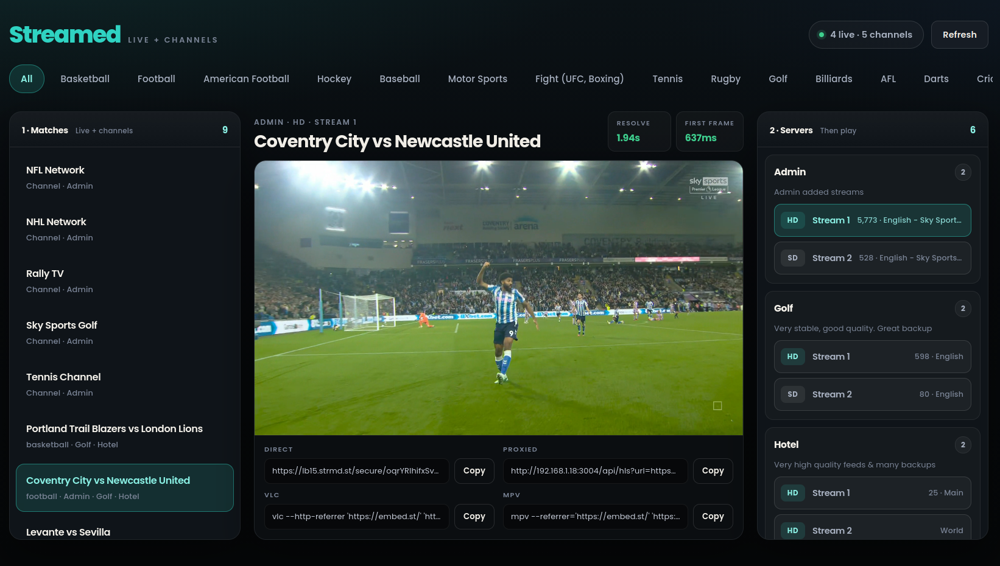
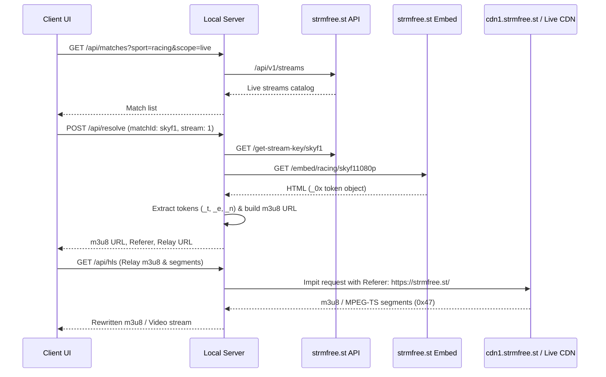

<div align="center">

# 📡 Streamed.pk HLS Stream Resolver

**Self-hosted HLS stream resolver for [streamed.pk](https://streamed.pk) / [strmfree.st](https://strmfree.st) live sports.**

Turn any match + server selection into a playable `.m3u8` playlist — extracting tokenized player metadata from `strmfree.st`, decrypting fallback GOAT `/fetch` responses, and serving a local HLS proxy that injects required `Referer`/`Origin` headers while unwrapping **MPEG-TS** video segments.

[](https://nodejs.org)
[](https://www.docker.com)
[](https://www.typescriptlang.org)
[](https://github.com/video-dev/hls.js)
[](LICENSE)

[Features](#-features) · [Quick Start](#-quick-start) · [Docker](#-docker) · [Cloudflare & Deployment Analysis](#-cloudflare-workers--pages-analysis) · [Usage](#-usage) · [How It Works](#-how-it-works) · [API](#-http-api) · [Disclaimer](#-disclaimer)

<p></p>

</div>

> [!IMPORTANT]
> **Repository:** [JOKERPADDY/streamed-pk-resolver](https://github.com/JOKERPADDY/streamed-pk-resolver).
> 
> This project is for research, interoperability, and personal playback only. Respect upstream ToS, copyright, and local law — see the [full disclaimer](#-disclaimer).

## ✨ Features

- 🔓 **strmfree.st & GOAT Resolver** — extracts live playback tokens (`_t`, `_e`, `_n`) and `/get-stream-key/` metadata directly from `strmfree.st`, with automated fallback to the GOAT `/fetch` WASM solver
- 🛡️ **Chrome TLS Transport** — Impit `chrome151` pooled transport for CDN segment pulls that would otherwise return 403
- 🧩 **MPEG-TS & WEBP Streaming** — streams raw `.js`/`.ts` MPEG-TS video segments directly, with automatic RIFF/WEBP container unwrapping
- 🚰 **Referer-aware HLS Proxy** — local `/api/hls` endpoint rewrites playlists and injects required `Referer`/`Origin` headers for players that cannot set custom headers
- 🖥️ **Built-in Player** — hls.js with official-embed buffer tuning (`maxBufferSize: 0`, `liveSyncDurationCount: 7`)
- 📋 **External Player Exports** — copy-paste VLC and mpv commands that point at the local relay, no referer flags needed
- 🏟️ **Live Catalog** — browse live sports matches and ranked server channels straight from `strmfree.st`
- 📺 **Dynamic IPTV M3U Playlist** — one-click download or copy a live `.m3u` playlist of every listed match/channel; entries unlock fresh at tune-in time
- ⚡ **Zero-Buffer Streaming Pipes** — responses are piped, keeping first-byte latency tied directly to upstream TTFB

---

## 🚀 Quick Start

### Prerequisites

- **Node.js 18+** with ESM support (or **Docker**)
- Network access to `strmfree.st` and upstream CDNs (`cdn1.strmfree.st`, `strmd.st`)

### Install & Run (Local Node.js)

```bash
git clone https://github.com/JOKERPADDY/streamed-pk-resolver.git
cd streamed-pk-resolver
npm install
npm start
```

Open **http://localhost:3000**. The `start` script builds TypeScript, frees the port if necessary, and starts the Node listener.

| Command | What it does |
| --- | --- |
| `npm start` | Build TypeScript, start listener on `http://localhost:3000` |
| `npm run build` | Compile server and client into `dist/` |
| `npm run typecheck` | Type-check TypeScript code without emitting |

The local Node app defaults to port `3000`; Docker/Render default to `10000`. Customize with `PORT`.

---

## 🐳 Docker

Run the resolver in a container using Docker Compose or Docker CLI.

### Using Docker Compose (Recommended)

```bash
docker compose up -d
```

The app will be accessible at **http://localhost:3004** (mapped from internal port `3000`).

To inspect logs or stop:

```bash
docker compose logs -f
docker compose down
```

### Using Docker CLI

```bash
# Build image
docker build -t streamed-pk-resolver .

# Run container
docker run -d --name streamed-pk-resolver -p 3004:10000 --restart unless-stopped streamed-pk-resolver
```

---

## ☁️ Cloudflare Workers / Pages Analysis

Thinking about deploying to **Cloudflare Workers / Pages (Free tier)** instead of **Render**? Here is a technical breakdown:

### ⚠️ Technical Challenges on Cloudflare Workers / Pages

1. **Node.js Native Dependencies & `impit`**:
   - The HLS segment proxy uses `impit` (which relies on native C++/Rust TLS bindings) to impersonate Chrome's TLS fingerprint (`chrome151`).
   - Cloudflare Workers run on V8 Isolates (not Node.js) and cannot execute native Node C++ addons or `impit` binaries.
2. **`worker_threads` & DOM Environment**:
   - The fallback WASM GOAT decryptor uses `worker_threads` and `happy-dom` (`src/goat/lock-worker.ts`), which are unsupported on Cloudflare Workers.
3. **Cloudflare Egress IP & 403 Blocks**:
   - Cloudflare Worker outbound `fetch()` requests use Cloudflare IP ranges. Upstream CDNs (`strmfree.st`, `cdn1.strmfree.st`) often block or issue 403/405 challenges to standard Cloudflare Worker egress IPs.
4. **Cloudflare ToS Section 2.8 (Video Bandwidth)**:
   - Proxying high-bandwidth live video streams through free Cloudflare Workers violates Cloudflare's Terms of Service (Section 2.8: *Non-HTML Content / Video Proxying* without Cloudflare Stream).
   - The 50 subrequest limit per Worker invocation and 100,000 free requests/day limit will quickly be exhausted when streaming live segment playlists.

### 💡 Recommended Deployment Platforms

| Platform | Free Tier | Docker / Node Runtime | Video Bandwidth | Verdict |
| --- | --- | --- | --- | --- |
| **Docker / Self-Hosted VPS** | N/A | Full Support | Unlimited | ⭐ **Best Performance** |
| **Koyeb Free** | 512MB RAM | Full Docker (Always-on) | Good | ⭐ **Best Free Alternative to Render** |
| **Render Free** | 512MB RAM | Docker (Sleeps after 15m) | Limited | Good for testing |
| **Cloudflare Workers** | 100k req/day | ❌ No (V8 Isolate) | ❌ Violates ToS | API catalog only |

---

## 🎮 Usage

The web UI provides a clean workspace to select and play live matches:

| Column | What you get |
| --- | --- |
| **Matches** | Filter live events by sport category |
| **Player** | Playback stage with hls.js player + copyable Direct, Proxied, VLC, and mpv links |
| **Servers** | Stream servers available for the selected event — click a server to resolve |

### 📺 External Players (VLC & mpv)

Export links directly from the UI:

```bash
# VLC Playback (using local proxied relay)
vlc "http://localhost:3000/api/hls?url=...&referer=https%3A%2F%2Fstrmfree.st%2F"

# mpv Playback
mpv "http://localhost:3000/api/hls?url=...&referer=https%3A%2F%2Fstrmfree.st%2F"
```

### 📺 IPTV M3U Playlist

Generate a live `.m3u` playlist for IPTV clients (e.g., TiviMate, OTT Navigator, VLC):

```bash
vlc http://localhost:3000/api/playlist
mpv --playlist=http://localhost:3000/api/playlist
```

---

## 🧠 How It Works



---

## 🌐 HTTP API

### `POST /api/resolve`

**Request Body (JSON):**
```json
{
  "matchId": "skyf1",
  "source": "embed",
  "stream": 1
}
```

**Response (JSON):**
```json
{
  "ok": true,
  "matchId": "skyf1",
  "title": "Sky Sports F1",
  "source": "embed",
  "stream": "1",
  "embedUrl": "https://strmfree.st/embed/racing/skyf11080p",
  "m3u8": "https://strmfree.st/live-cdn/skyf11080p/index.m3u8?_t=...&_e=...&_n=...",
  "referer": "https://strmfree.st/",
  "relay": "http://localhost:3000/api/hls?url=...&referer=..."
}
```

### `GET /api/hls`

Parameters:
- `url`: Upstream `.m3u8` or segment URL.
- `referer`: Required referer (`https://strmfree.st/`).

### `GET /api/playlist`

Returns a dynamic `#EXTM3U` playlist of all currently live streams.
Query parameters:
- `sport`: Filter by category (e.g., `football`, `racing`, `tennis`, `all`).
- `download=1`: Triggers browser file download (`streamed-pk-<sport>.m3u`).

---

## ⚙️ Configuration

Environment variables (`src/config/site.ts`):

| Variable | Default | Purpose |
| --- | --- | --- |
| `PORT` | `3000` | HTTP listening port |
| `STREAMED_ORIGIN` | `https://strmfree.st` | Upstream catalog & API origin |
| `EMBED_ORIGIN` | `https://strmfree.st` | Upstream embed & referrer origin |
| `USER_AGENT` | Desktop Chrome UA | Outbound HTTP headers |

---

## 📄 License

Released under the [MIT License](LICENSE).

## ⚖️ Disclaimer

This project is for research, interoperability, and personal playback against publicly accessible endpoints. Respect upstream terms of service, copyright, and local law. Do not use it to redistribute or monetize streams.
